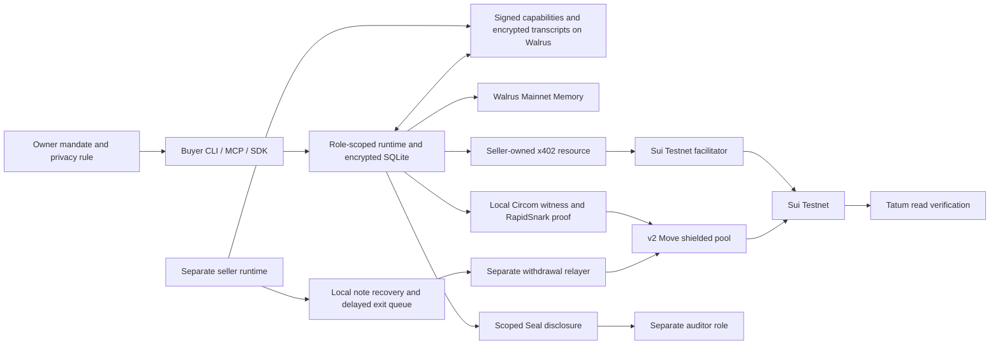

# Supercuts architecture

Supercuts joins private agent negotiation to public or shielded settlement. Walrus stores the encrypted deal trail; Walrus Memory preserves typed preferences and outcomes so later decisions can use them. The runtime enforces owner policy before a memory-guided choice becomes a payment.

## System map

The buyer, each seller, auditor, and withdrawal relayer use separate owner-only state homes and keys. Agent-facing tools receive typed results and redacted evidence, not wallet material or note openings. The TypeScript SDK invokes a one-request subprocess seam so keys remain inside the Supercuts runtime.

## Deal lifecycle

1. **Discover:** A seller signs a capability registration and publishes it through Walrus. The buyer verifies the registration and checks its mandate.
2. **Negotiate:** Buyer and seller exchange signed, encrypted offers. The transcript has an authenticated ordering and a Walrus blob trail. An accepted agreement binds the exact amount, parties, capability, and operation.
3. **Choose a rail:** The settlement planner applies the standing policy and trusted typed Walrus Memory recall. A remembered owner rule can require the shielded rail; verified outcome memories can inform later choices. A model response cannot relax the owner rule.
4. **Pay publicly:** The seller-owned protected resource returns an x402 `402` challenge. The buyer signs the exact SUI transfer, the facilitator validates and relays it, and the resource verifies final payment before delivery.
5. **Pay confidentially:** The buyer uses a prefunded v2 note, constructs the witness locally, proves the transfer, and submits it to the pinned Move pool. The seller recovers its note from finalized pool evidence and may queue a standard delayed exit.
6. **Verify and deliver:** The runtime checks Sui and Tatum finality, reconciles a stable operation ID, and verifies the delivered artifact. A pending or ambiguous broadcast reuses its journaled signed bytes.
7. **Disclose when authorized:** Seal encrypts a deal-specific package for the designated auditor after the required approvals and finalized evidence.

## Components

| Component | Responsibility |
| --- | --- |
| [`backend`](backend) | CLI, MCP, SDK seam, role policy, encrypted state, seller runtime, resource, facilitator, event checker |
| [`contracts`](contracts) | Sui Move pool, verifier storage, nullifier/replay and custody guards |
| [`circuits`](circuits) | v2 deposit, transfer, withdrawal circuits and locally generated proofs |
| [`crates`](crates) | Protocol encoding and verification helpers |
| [`config/phase1.testnet.json`](config/phase1.testnet.json) | Pinned v2 package, pool, proof artifact hashes, and Testnet scope |
| [`seal-policy`](seal-policy) | Scoped auditor approval policy |
| Walrus / Walrus Memory | Signed capability registrations and encrypted deal transcripts; encrypted typed preferences, rules, and outcome memories |
| Sui / Tatum | Transaction submission and independent finalized evidence reads |

## Privacy and custody boundary

Public x402 work uses a normal Testnet SUI transfer, so amount and payee are visible. The pool commits the confidential deal amount and counterparty in the proof instead of writing a direct transfer to the seller. Funding, deposits, withdrawals, payout addresses, gas, timing, and pool activity remain visible. Standard-sized deposits and delayed exits reduce some linkage, but a small Testnet pool is not a strong anonymity set.

State directories are mode `0700`; credential files are mode `0600`. Memory plaintext is embedded and encrypted locally; the Walrus Memory relayer receives ciphertext. The 1536-dimensional embedding adapter must be used for writes and recall. The live v2 pool is experimental and test-only. Existing v1 notes stay on their pinned v1 pool and are not silently migrated.

See [`docs/protocol-v1.md`](docs/protocol-v1.md), [`docs/pool-v2.md`](docs/pool-v2.md), and [`backend/README.md`](backend/README.md) for statement and runtime details.
